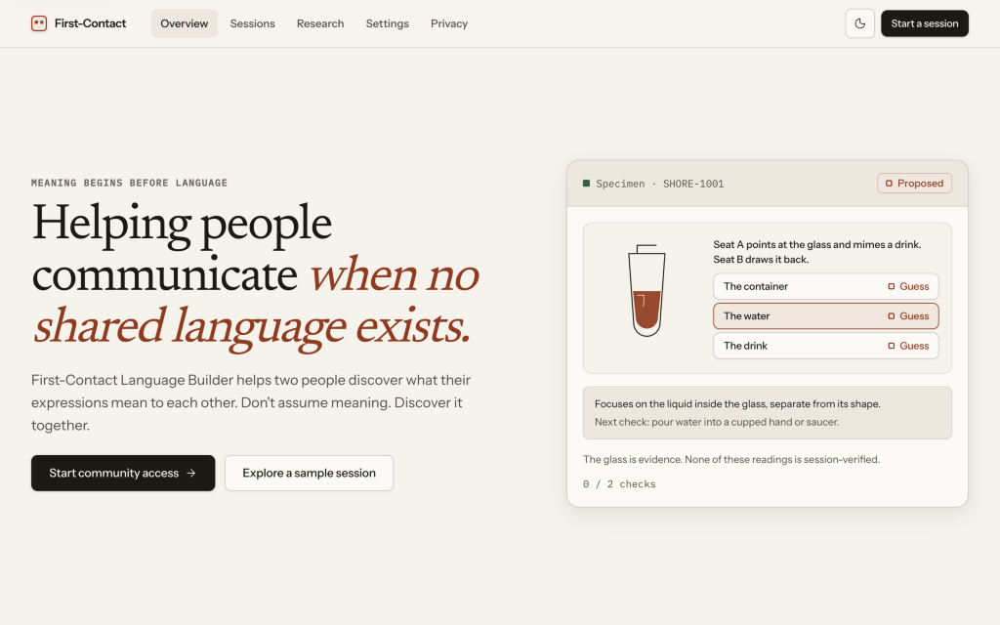
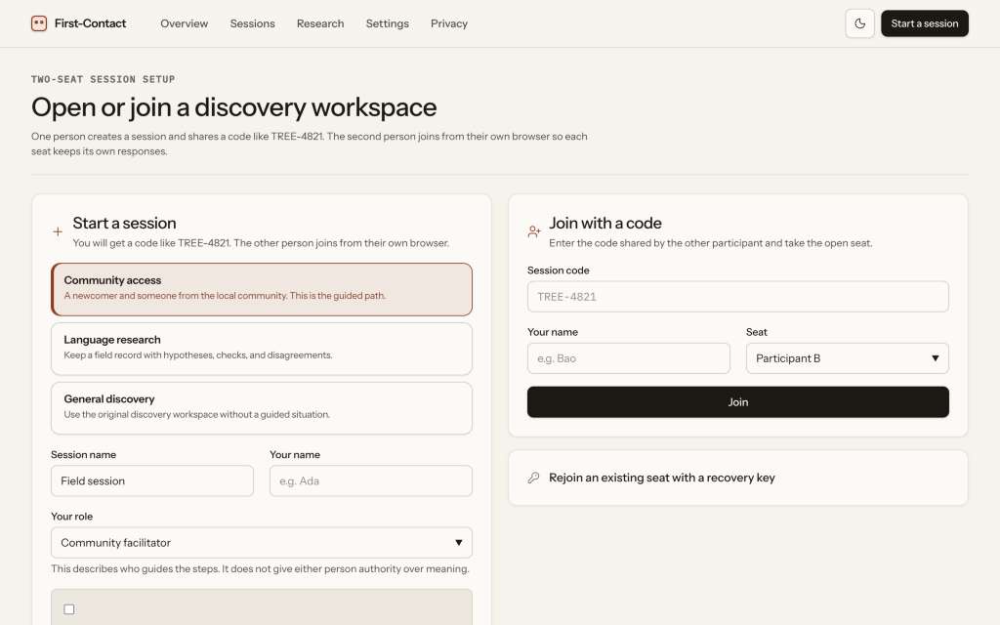
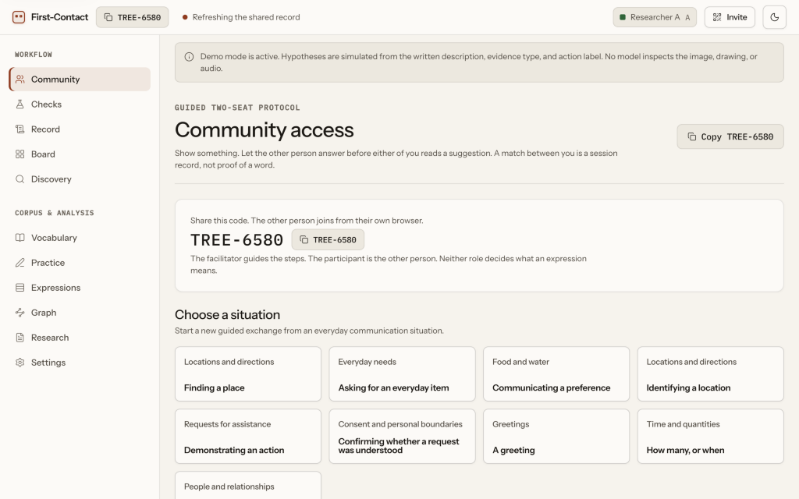

# First-Contact Language Builder

A two-seat workspace for working out what expressions mean when two people do not share a language. Each participant records evidence, holds competing readings open, runs checks to tell those readings apart, and locks an answer before seeing the other seat's reply. A meaning becomes session-verified only when the session's checks pass, not because someone clicked accept on a suggestion.

Live site: [first-contact-language-builder.vercel.app](https://first-contact-language-builder.vercel.app)

The hosted deployment runs in demo mode. Hypotheses and check suggestions there are simulated from the written description, the evidence type, and the action label. No model inspects uploaded images, drawings, or audio on the live site.


## Screenshots

Landing page with the `SHORE-1001` specimen card:



Session setup for creating or joining a two-seat workspace:



Community access workspace with guided situations, session code, and demo-mode banner:



## How it works

One person creates a session and shares a code such as `TREE-4821` or its QR link. A second person opens the app in a separate browser and joins the open seat as Seat A or Seat B. Each seat receives a recovery key saved in that browser's local storage. A session code alone cannot reclaim a seat that has already been taken.

1. Record evidence. Either seat adds a camera photo, uploaded image, drawing, microphone recording, gesture description, demonstration note, short video, or written note. Files stay in `data/uploads/<sessionId>` during local development or in a private Supabase bucket in production.
2. Hold competing readings. The demo facilitator or an optional OpenAI-compatible provider proposes several interpretations alongside what remains ambiguous. Accepting a reading saves it as a tentative entry rather than a verified meaning.
3. Design checks. Participants or the assistant propose structured checks such as visual discrimination, context testing, reverse demonstration, contrast testing, or repeated trials. Each check lists what different outcomes would support or weaken.
4. Lock replies independently. Each participant writes and locks a response without seeing the other seat's answer. The API withholds one seat's response until both seats have locked.
5. Session verification. A concept reaches `verified` inside that session only when all of these conditions hold:
   - a participant has accepted the wording,
   - two participants recorded matching checks,
   - at least two distinct stimuli were tested,
   - at least two different experiment methods were used,
   - no disagreement is on record in the current round, and
   - at least 75% of recorded responses matched.

Matches from a single participant stay a facilitator-supported observation (`tentative`) rather than shared session verification. Session verification applies only within that session and can be reopened at any time.

Verified concepts feed the searchable vocabulary board, expression trials combining existing concepts (with any word-order notes marked as hypotheses), and practice prompts drawn only from entries that session recorded.

## AI functionality

`lib/ai` separates hypothesis analysis and experiment planning behind a provider interface (`getProvider()`).

Demo mode is the default unless both `AI_PROVIDER=openai` and a non-empty `OPENAI_API_KEY` are configured on the server. Demo mode generates readings and check suggestions from text fields and labels. It never inspects file bytes and labels every output as simulated. This is what the hosted submission deployment runs.

When an OpenAI-compatible provider is configured on the server, `OPENAI_API_KEY` stays server-side. Individual media bytes are sent only when the participant checks per-item analysis consent (`consentToAnalyze`), and only for images (`image/jpeg`, `image/png`, `image/gif`, `image/webp` up to 4 MB) or audio (`wav` or `mp3` when `OPENAI_AUDIO_MODEL` is also set). Browser `webm` recordings stay stored without being sent, and full videos are never sent (participants can submit one frame as an image instead).

Live experiment planning requires both per-item analysis consent (evidence without consent has its text omitted in `groundSnapshot`) and an explicit facilitator confirmation (`shareWithModel`). Raw media bytes are not sent during experiment planning.

If a live provider errors, rate-limits, times out, or returns invalid JSON, the server returns an HTTP error (`429`, `502`, `503`, or `504`) and never falls back to a simulated result. AI cannot accept a hypothesis on behalf of a participant, bypass blinded locking, or mark a concept verified.

## Technology stack

- Next.js 15 App Router, React 19, TypeScript
- Tailwind CSS v4, custom design tokens in `app/globals.css`, Lucide icons, Framer Motion, shadcn-style button utilities (`class-variance-authority`, `clsx`, `tailwind-merge`)
- Zod validation, Prisma ORM (`@prisma/client`) with SQLite locally and PostgreSQL (`pg`) in production
- `d3-force` for concept graph layout, `qrcode` for session invite codes
- Vitest and Playwright (`playwright-core`)
- Vercel (`@vercel/speed-insights`) and Supabase (PostgreSQL and private storage) for the hosted deployment

## Architecture

Pages and components call Next.js Route Handlers under `app/api`. Handlers validate payloads with Zod and delegate writes to `lib/domain`, where queries are scoped by `sessionId` and gated by participant token resolution (`lib/access/credentials.ts`).

Presence and session updates poll `/api/sessions/[code]/sync` roughly every 2.5 seconds on Vercel. On a local Node server, `/api/sessions/[code]/stream` can push server-sent events for up to 45 seconds before closing.

```
app/                  Next.js App Router pages, layout, and API routes
components/           Workspace shell, discovery, checks, vocabulary, graph, research UI
lib/
  access/             Token hashing, AccessCredential lookup, seat policy
  ai/                 Demo provider, OpenAI-compatible provider, live experiment planner
  community/          Guided community-access scenarios and visibility helpers
  database/           Prisma client setup
  demo/               SHORE-1001 illustrative data and operator helpers
  domain/             Session writes, discovery, checks, serialization, exports
  experiments/        Experiment state, blinded reply filtering, quality checks
  learning/           Practice prompt builder
  media/              HMAC URL signing and expiry checks
  security/           Database and Redis rate limiting (RateLimitBucket)
  storage/            Local filesystem vs private Supabase storage
  verification/       Session-verified threshold rule and stimulus identity
prisma/
  schema.prisma       SQLite schema for local development
  schema.postgresql.prisma  PostgreSQL schema for hosted deployments
  migrations/         PostgreSQL SQL migrations (including RateLimitBucket and RLS hardening)
  seed.ts             Seeds the SHORE-1001 illustrative sample session
scripts/              Environment check, DB setup/copy/migrate, smoke and browser journeys
tests/                Vitest suites for verification rules, access control, AI, and migrations
docs/screenshots/     Application screenshots referenced in docs
```

## Local installation

Requirements: Node 20+ and npm.

1. Clone and install dependencies:

```bash
git clone https://github.com/sharmao07/first-contact-language-builder.git
cd first-contact-language-builder
npm install
```

2. Create a local environment file:

```bash
cp .env.example .env
```

The defaults in `.env.example` run with SQLite (`DATABASE_URL="file:../data/first-contact.db"`), local file uploads, and demo AI mode. No cloud keys are required locally.

3. Set up the database and seed the `SHORE-1001` sample session:

```bash
npm run db:setup
```

`db:setup` runs `prisma generate && prisma db push && tsx prisma/seed.ts`. It creates `data/first-contact.db` (resolved relative to `prisma/`) and populates `SHORE-1001`, an illustrative sample containing water/container/drinking evidence splits, a rejected reading, a disputed gesture, completed checks, practice prompts, an expression trial, and research notes.

4. Start the development server:

```bash
npm run dev
```

Open [http://localhost:3000](http://localhost:3000).

5. Test, check, and build commands (from `package.json`):

```bash
npm test           # Vitest unit tests
npm run typecheck  # TypeScript check (tsc --noEmit)
npm run lint       # ESLint
npm run build      # Generates the Prisma schema for build and runs next build
npm run start      # Starts the built production Next.js server
npm run smoke      # Runs HTTP end-to-end checks against a running server on port 3000
```

Local schema and sample maintenance:

```bash
npm run db:push    # Apply prisma/schema.prisma to local SQLite
npm run db:seed    # Reset and re-seed SHORE-1001 only
```

## Environment variables

Configured in `.env.example`:

| Variable | Local default | Purpose |
| --- | --- | --- |
| `DATABASE_URL` | `file:../data/first-contact.db` | SQLite locally (relative to `prisma/`), or Supabase transaction pooler URL (`:6543`, `?pgbouncer=true&connection_limit=1`) in production |
| `DIRECT_URL` | unset | Hosted only. Direct PostgreSQL URL (`:5432`) for `npm run db:migrate` and `npm run db:copy` |
| `AI_PROVIDER` | `demo` | `demo` or `openai` |
| `OPENAI_API_KEY` | empty | Server-only API key; empty keeps demo mode active |
| `OPENAI_BASE_URL` | `https://api.openai.com/v1` | OpenAI-compatible base URL |
| `OPENAI_MODEL` | `gpt-4o-mini` | Chat model for hypotheses and planning |
| `OPENAI_AUDIO_MODEL` | empty | Optional model for consented `wav`/`mp3` acoustic descriptions |
| `AI_TIMEOUT_MS` | `25000` | Request timeout in milliseconds |
| `STORAGE_PROVIDER` | `local` | `local` (`data/uploads`) or `supabase` |
| `SUPABASE_URL` | empty | Hosted only. Supabase project URL |
| `SUPABASE_SERVICE_ROLE_KEY` | empty | Hosted only. Server-only service key |
| `SUPABASE_STORAGE_BUCKET` | `session-media` | Hosted only. Must be a private bucket |
| `MEDIA_SIGNING_SECRET` | empty | Required on hosted deployments (16+ chars). Local dev falls back to a built-in development key |
| `MEDIA_URL_TTL_SECONDS` | `900` | Signed media URL lifetime (60 to 3600 seconds) |
| `RATE_LIMIT_STORE` | `auto` | Uses Upstash/Vercel KV Redis REST if configured, otherwise atomic database `RateLimitBucket` rows (never in-memory) |
| `UPSTASH_REDIS_REST_URL` / `UPSTASH_REDIS_REST_TOKEN` | empty | Optional Redis REST credentials for rate limiting |
| `ALLOW_DEMO_OPERATOR` / `DEMO_OPERATOR_SECRET` / `DEMO_OPERATOR_DISABLED` | empty | Local-only controls for `/api/demo/enter` and `/api/demo/reset` (disabled automatically on Vercel preview/production) |
| `RECOVERY_TOKEN_TTL_HOURS` / `DEMO_ENTRY_TTL_MINUTES` | `168` / `120` | Token lifetimes for newly issued recovery and demo credentials |
| `MAX_IMAGE_BYTES` / `MAX_AUDIO_BYTES` / `MAX_VIDEO_BYTES` | `8000000` / `10000000` / `25000000` | Upload size limits |
| `SYNC_TRANSPORT` | empty | Optional `stream` locally; `poll` is forced on Vercel |

Run `npm run env:check` to validate environment configuration without printing secret values. Never commit `.env` or secret values.

For hosted PostgreSQL deployments, `npm run db:migrate` runs `scripts/migrate-postgres.mjs` against `DIRECT_URL`, and `npm run db:copy` inspects local counts or copies an empty Postgres database when `CONFIRM_DATA_COPY=yes`. `/api/health` checks database, storage, and media signing status and returns `503` if any check fails.

## Security and privacy

Joining a session issues a token stored in browser local storage and hashed server-side in `AccessCredential`. Leaving a session revokes active access for that seat until rejoined with its key. Hosted deployments reject the legacy sample tokens.

Domain readers and writers check the participant token against the target session and seat role. In community sessions, hidden facilitator plans, hypothesis counts, and private check wording are redacted from the participant seat (`lib/community/visibility.ts` and `lib/experiments/privacy.ts`).

Uploads live outside `public/`. `GET /api/media/[id]` requires either a valid HMAC-signed `?exp=...&sig=...` query or a matching `x-participant-token` header; a bare `?code=` parameter is rejected. Participant SVG uploads are blocked, and media responses include `Content-Security-Policy: sandbox`.

Session creation, joins, rejoins, uploads, and AI calls are rate-limited across IP, session code, and actor dimensions via `RateLimitBucket` database rows or Redis REST, failing closed (`503`) if the store is unavailable. Production PostgreSQL migrations enable Row Level Security on all public tables without `anon` or `authenticated` policies and revoke public table, function, and sequence privileges.

Uploaded media is sent to an external AI provider only when `consentToAnalyze` is checked on that evidence item, within format and size caps.

## Current limitations

Production runs in demo mode and does not inspect images, drawings, or audio bytes. `SHORE-1001` is invented sample data, and the tool has not been evaluated in fieldwork with people who share no language.

Session verification is local to the session: `verified` means two seats met the threshold on two stimuli and two methods inside that session, not that the meaning holds generally or transfers elsewhere. Sessions have two seats (A and B) with no separate observer seat, and on Vercel seats synchronize by polling roughly every 2.5 seconds.

As recorded in `HACKATHON-DEMO-SCRIPT.md` and `GLOBAL-AI-RUBRIC-EVIDENCE.md`, the 27 November hosted production browser pass confirmed session creation, joining, evidence upload, and hypothesis isolation before a community-page navigation timed out, and an earlier production script check hit `status=undefined` because it repeated a non-varied check method (`context_testing`). Locally against `next start` and SQLite on 28 November 2026, the full unit suite, `scripts/community-browser.mjs` (7/7), and `scripts/full-workflow-browser.mjs` (18/18) passed, covering community lock/reveal, single-method awaiting, disagreement (`disputed`), below-75% match rate (`awaiting`), and cross-seat access restrictions; those local runs do not replace hosted production re-testing.

There are no user accounts, and local SQLite files and uploaded media on disk are not encrypted at rest.

### AI-assisted development

Cursor was used for debugging and code assistance during development. Suggested changes were reviewed and checked against the application's behavior using automated tests and browser workflows.

## Contributing

Run the checks before proposing changes:

```bash
npm test && npm run typecheck && npm run lint
```

With a local server running on port 3000:

```bash
npm run smoke
```
